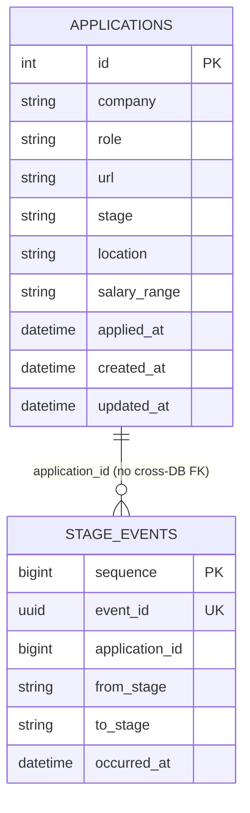

# Data model

Each service owns its own Azure SQL database. There are **no foreign keys across
databases**. Insights stores `application_id` as a plain integer reference; the
applications service remains the source of truth for the current board state.

The diagrams match the Alembic migrations applied on startup:

- `applications-api/migrations/versions/0001_create_applications_table.py`
- `insights-api/migrations/versions/0001_create_stage_events.py`

## Overview

## applications-api (`applications` table)

| Column | Type | Notes |
| --- | --- | --- |
| `id` | integer, identity | Primary key |
| `company` | string(200), not null | Required |
| `role` | string(200), not null | Required |
| `url` | string(2048), nullable | Optional posting URL |
| `stage` | string(20), not null | Default `applied`. Check constraint: `applied`, `screen`, `interview`, `offer`, `rejected` |
| `location` | string(200), nullable | |
| `salary_range` | string(100), nullable | Free text |
| `applied_at` | datetime with time zone, nullable | `DATETIMEOFFSET` on SQL Server |
| `created_at` | datetime with time zone, not null | Default `CURRENT_TIMESTAMP` |
| `updated_at` | datetime with time zone, not null | Default `CURRENT_TIMESTAMP`; repositories refresh it on write |

Index: `ix_applications_stage` on `stage`.

## insights-api (`stage_events` table)

| Column | Type | Notes |
| --- | --- | --- |
| `sequence` | bigint, identity | Primary key; breaks ties when `occurred_at` values match |
| `event_id` | UUID, unique | Idempotent intake key from the sender |
| `application_id` | bigint, not null | Soft reference to `applications.id` |
| `from_stage` | string(16), nullable | Null means creation |
| `to_stage` | string(16), nullable | Null means deletion |
| `occurred_at` | datetime, not null | Stored as UTC; `DATETIME2(6)` on SQL Server |

Index: `ix_stage_events_history` on `(application_id, occurred_at, sequence)`.

## Sync between the services

When an application is created, moved or deleted, `applications-api` sends
`POST /events` to `insights-api` with a short timeout. A failed or timed-out
send must not break the board write: the board keeps the new state and insights
may lag until a later successful event (or stay incomplete for that change in
the MVP). Identical retries reuse the same `event_id`.
