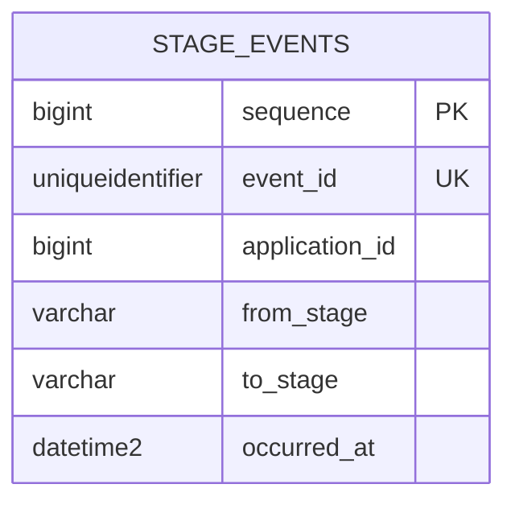

# Insights API

Insights stores stage events in its own Azure SQL database. The Applications API owns
the application records. The Insights database has no cross-database foreign keys.

## Run and migrate

From `insights-api/`, install the dependencies with
`python -m pip install -r requirements-dev.txt`. Install Microsoft's ODBC Driver 18
for SQL Server on the host, or use an image with that driver. Set `INSIGHTS_DB_URL`
to the Insights database SQLAlchemy `mssql+pyodbc` URL and `INSIGHTS_API_KEY` to the
same secret used by the sender. Keep values in environment variables or app secrets.
Production should use encrypted connections with server certificate validation.

Run `python -m uvicorn app.main:app --port 8001 --no-access-log`.
Startup probes the database and runs Alembic to `head` by default. A repeat startup
with the same database leaves the schema and events in place. Use
`python -m alembic current` to inspect the version. `RUN_MIGRATIONS_ON_STARTUP=false`
is for a database whose schema was already migrated. Without a URL the service can
run health checks, and event intake returns 503.

For image packaging, the Insights image needs the same ODBC Driver 18 install,
`COPY migrations/`, and `COPY alembic.ini` steps as the Applications API image in
the team's Dockerfile PR. Retain port 8001 and allow for the startup database wait.

## Event contract

`POST /events` requires `X-API-Key` and JSON with a UUID `event_id`, positive integer
`application_id`, `occurred_at` as an ISO datetime, and `from_stage` / `to_stage`
as stage values or null. Stages are `applied`, `screen`, `interview`, `offer`, and
`rejected`. A null source represents creation, and a null destination represents
deletion. Each event must describe a change. Offset timestamps are converted to UTC.
Naive timestamps are interpreted as UTC.

A committed event or an identical replay returns HTTP 202 with
`{"status":"accepted","event_id":"<uuid>"}`. Replay the same UUID and normalized
payload for retries. A different payload using the same UUID returns 409. Invalid
input returns 422, a missing or wrong key returns 401 when a key is configured, and
unavailable event storage or missing service configuration returns 503.

## Insights data model

Migration `0001` creates the table and indexes history by application, UTC event
time, and insertion sequence. The sequence breaks ties for equal timestamps.
An out-of-order delivery is stored and sorted by event time when read.

## Verification

Run `python -m pytest -q`, `python -m ruff check .`, and
`python -m black --check .` from the service directory.
Set `INSIGHTS_TEST_SQLSERVER_URL` to a disposable local SQL Server database to
enable the integration test. The test writes events, checks replay and rollback,
and starts a second app instance to verify the migration and data survive restart.
The standard suite also renders the migration as SQL Server SQL without a database.
